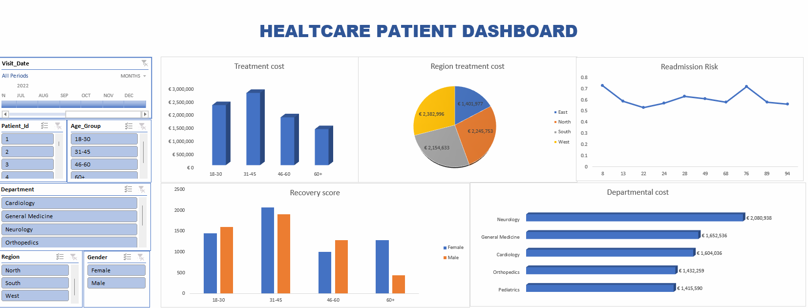

# Data Analytics Portfolio

# Project 1

**Title:** [HealthCare Analysis](https://github.com/olawoye1011/olawoye1011.github.io/blob/main/Health_care_project.xlsx)

**Tools Used:** Microsoft Excel, Pivot Table, Slicer, Power Query

**Project Description:**

**Key findings:**

**Dashboard Overview:**

# Project 2

**Title:** Data Definition Language-Employee records

**SQL Code:** [DDL- Employee records sql code](https://github.com/olawoye1011/olawoye1011.github.io/blob/main/DDL.SQL)

**SQL Skills Used:**

**Project Description:**

**Technology used:** SQL server
